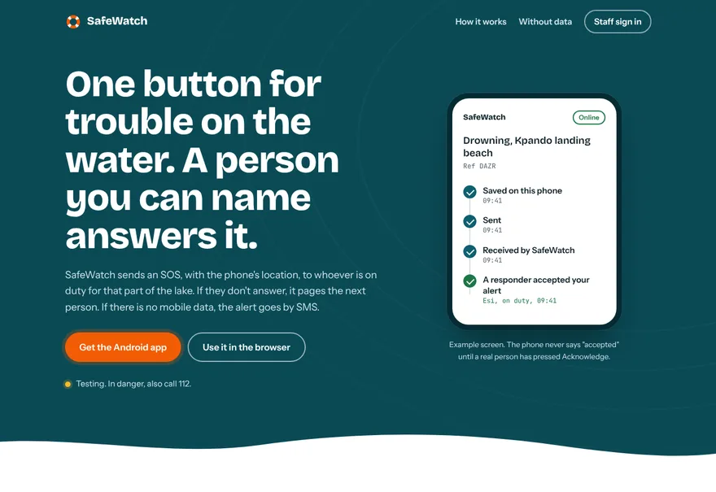
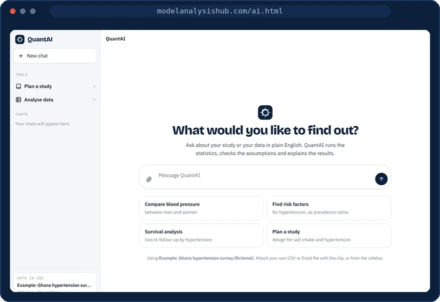
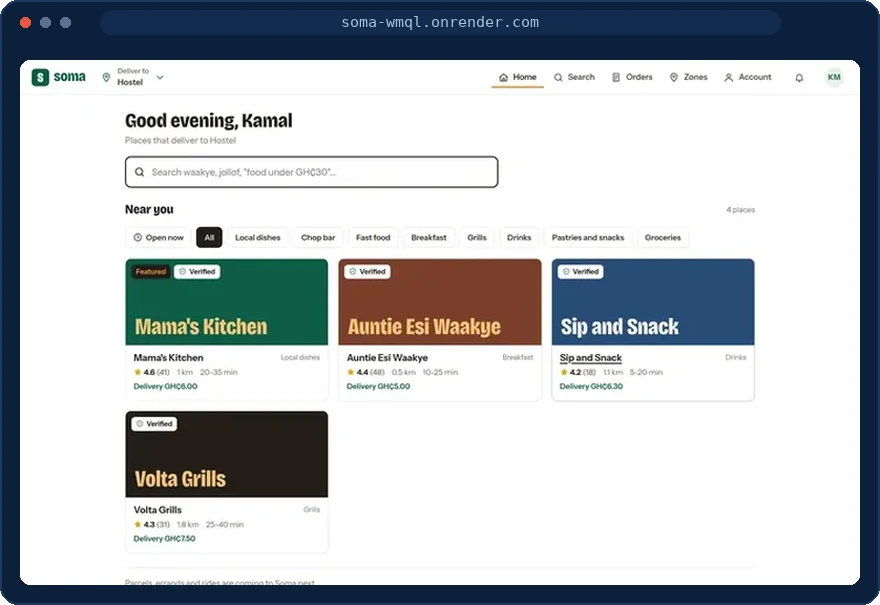
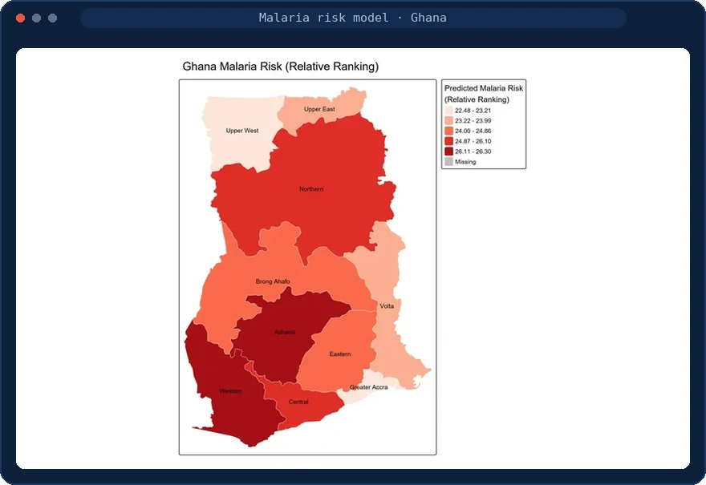
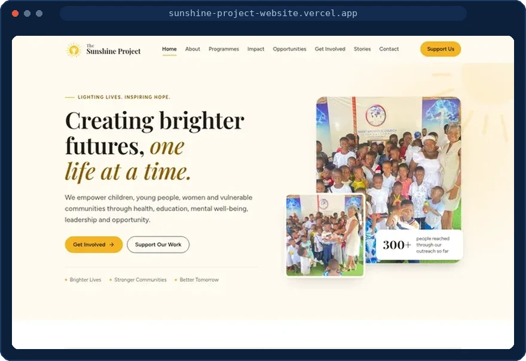
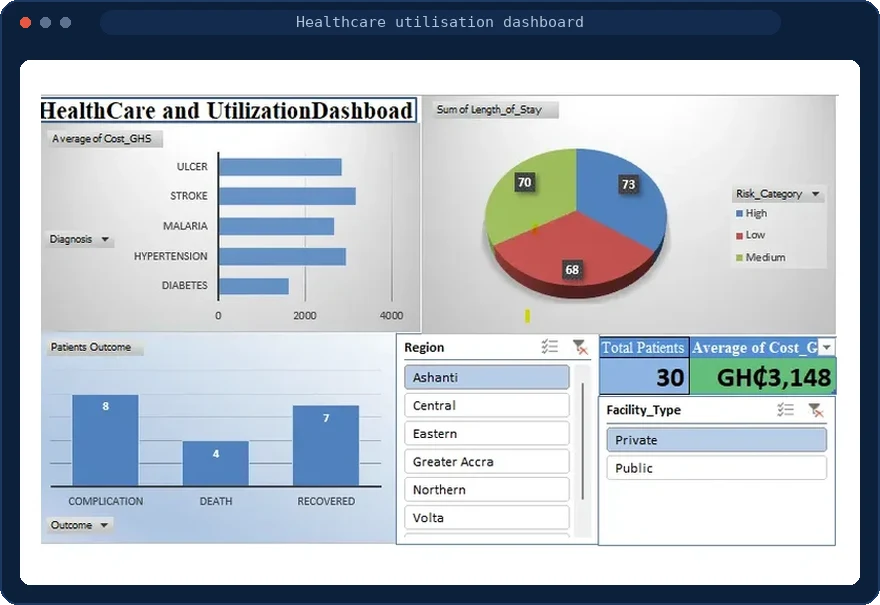
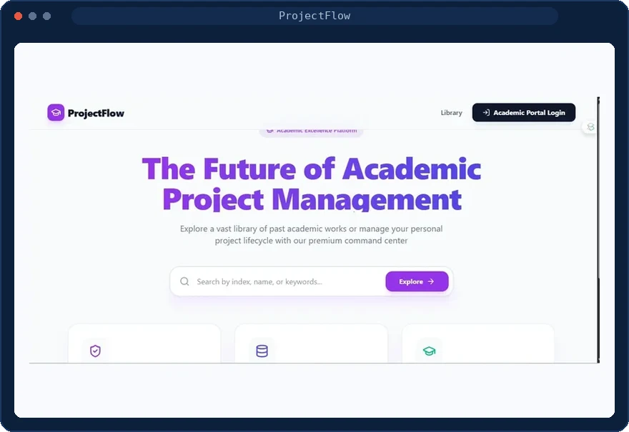

  <a href="https://modelanalysishub.com"><b>modelanalysishub.com</b></a> &nbsp;·&nbsp;
  <a href="https://modelanalysishub.com/ai.html">QuantAI</a> &nbsp;·&nbsp;
  <a href="https://modelanalysishub.com/opportunities.html">Opportunities</a> &nbsp;·&nbsp;
  <a href="https://www.linkedin.com/in/amadu-kamal-65ab5326a">LinkedIn</a> &nbsp;·&nbsp;
  <a href="https://wa.me/233595586430">WhatsApp</a> &nbsp;·&nbsp;
  <a href="mailto:amadukamal8@gmail.com">Email</a>

 

I'm **Amadu Kamal**, a data analyst and software engineer from Ghana and the founder of **[Model Analysis Hub](https://modelanalysishub.com)**.

I work in the gap between good analysis and real decisions. Too often a careful model stays in a report while the decision is made from a spreadsheet. So I build both halves: the statistics you can defend in front of reviewers, and the software that puts the result in front of the people who use it.

> **My standard is short:** the numbers have to be right, and someone has to use the result.

 

 

## What I do

Also in the toolkit: Stata · SciPy · scikit-learn · Leaflet · Cloudflare Workers · Vercel · Render

 

## Selected work

<table>
  <tr>
    <td colspan="2" valign="top">
      
      <h3>SafeWatch</h3>
      <b>GRANT PROJECT · WATER EMERGENCY ALERTS · 2026</b>
      
People drown on the Volta Lake every year and help often starts late. SafeWatch sends an SOS with the phone's location to the person on duty for that stretch of water, and calls the next person if nobody answers. It works from an Android app, a browser, plain SMS or a dial code on any phone. Fishers can say when they'll be back, and if they don't check in the alert goes out by itself. Storm warnings go out in Ewe, Twi and English.

      <code>Python</code> <code>FastAPI</code> <code>PostgreSQL</code> <code>React</code> <code>React Native</code> <code>SMS and USSD</code>  
      <a href="https://safewatch-xyqr.onrender.com"><b>Open SafeWatch →</b></a> &nbsp;·&nbsp; <a href="https://modelanalysishub.com/projects.html#safewatch"><b>Case study →</b></a>
    </td>
  </tr>
  <tr>
    <td width="50%" valign="top">
      
      <h3>QuantAI</h3>
      <b>OWN PRODUCT · 2026</b>
      
A free research and statistics assistant. Upload a spreadsheet and ask in plain English: it checks the data, picks each test from assumption checks, fits regression and survival models, and exports every analysis as <b>Stata, Python, R and SPSS</b> code. All numbers are verified against SciPy and statsmodels.

      <a href="https://modelanalysishub.com/ai.html"><b>Open QuantAI →</b></a>
    </td>
    <td width="50%" valign="top">
      
      <h3>Soma</h3>
      <b>OWN PRODUCT · FOOD DELIVERY · 2026</b>
      
A local food delivery platform for the Volta Region: customer, vendor, rider and admin apps in one. Mobile Money and card payments through Paystack with automatic payouts, PIN-confirmed delivery and an installable web app.

      <a href="https://modelanalysishub.com/projects.html#soma"><b>Case study →</b></a>
    </td>
  </tr>
  <tr>
    <td width="50%" valign="top">
      
      <h3>Malaria risk across Ghana</h3>
      <b>GEOSPATIAL EPIDEMIOLOGY · 2025</b>
      
A spatial model combining climate, population density and historical cases to rank regional malaria risk and estimate the probability that prevalence exceeds 30%, validated region by region against observed data.

      <a href="https://modelanalysishub.com/projects.html#malaria-risk"><b>See the maps →</b></a>
    </td>
    <td width="50%" valign="top">
      
      <h3>The Sunshine Project</h3>
      <b>CLIENT · NGO WEBSITE · 2026</b>
      
A multi-page website for a Ghanaian NGO, with an admin login so the team updates programmes, schedules and photos themselves without a developer.

      <a href="https://sunshine-project-website.vercel.app"><b>Visit the site →</b></a>
    </td>
  </tr>
  <tr>
    <td width="50%" valign="top">
      
      <h3>Healthcare utilisation dashboard</h3>
      <b>DASHBOARD · HEALTH DATA</b>
      
Cost by diagnosis, length of stay by risk category and patient outcomes on one screen, with region and facility filters so managers answer their own questions.

      <a href="https://modelanalysishub.com/projects.html#healthcare-dashboard"><b>Details →</b></a>
    </td>
    <td width="50%" valign="top">
      
      <h3>ProjectFlow</h3>
      <b>WEB PLATFORM · 2025</b>
      
A full-stack system that takes university research projects (undergraduate to PhD) from first draft to final publication, with supervisor tracking and a searchable project library.

      <a href="https://modelanalysishub.com/projects.html#projectflow"><b>Details →</b></a>
    </td>
  </tr>
</table>

 

## Open source

<table>
  <tr>
    <td width="50%" valign="top">
      <h3><a href="https://github.com/kamaldeenjnr/stroke-risk-prediction">stroke-risk-prediction</a></h3>
      
A machine-learning pipeline for stroke risk on real clinical data, where only 4.9% of patients have the outcome. It handles the imbalance with SMOTE and tunes the model for 80% recall, because a screening tool must catch at-risk patients.

      <code>Python</code> <code>scikit-learn</code> <code>SMOTE</code>
    </td>
    <td width="50%" valign="top">
      <h3><a href="https://github.com/kamaldeenjnr/model-analysis--hub">model-analysis--hub</a></h3>
      
The source of modelanalysishub.com, including QuantAI's in-browser statistics engine: assumption-checked tests, GLMs, Cox, ordinal, multinomial and mixed models, all in plain JavaScript.

      <code>JavaScript</code> <code>Cloudflare Workers</code> <code>GitHub Pages</code>
    </td>
  </tr>
</table>

 

## Work with me

Have data that should drive a decision, or a website or platform to build? Send a short message saying what you have and what you need from it. Replies usually come the same day.

  <a href="https://wa.me/233595586430"><b>WhatsApp +233 59 558 6430</b></a> &nbsp;·&nbsp; <a href="mailto:amadukamal8@gmail.com">amadukamal8@gmail.com</a>

Built in Ghana · <a href="https://modelanalysishub.com">modelanalysishub.com</a>
