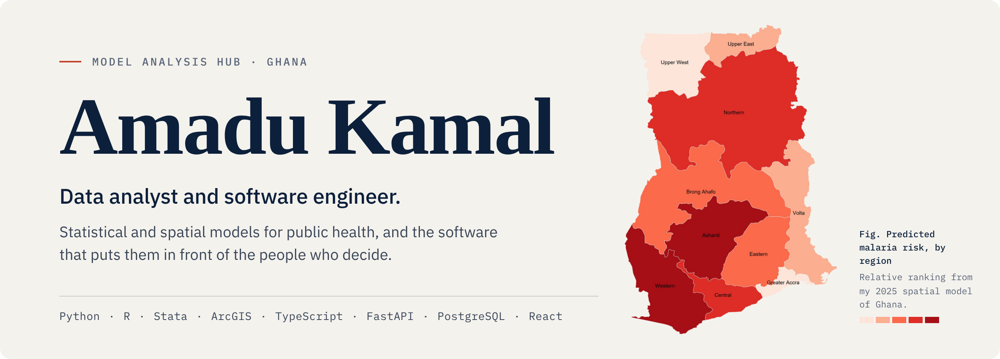
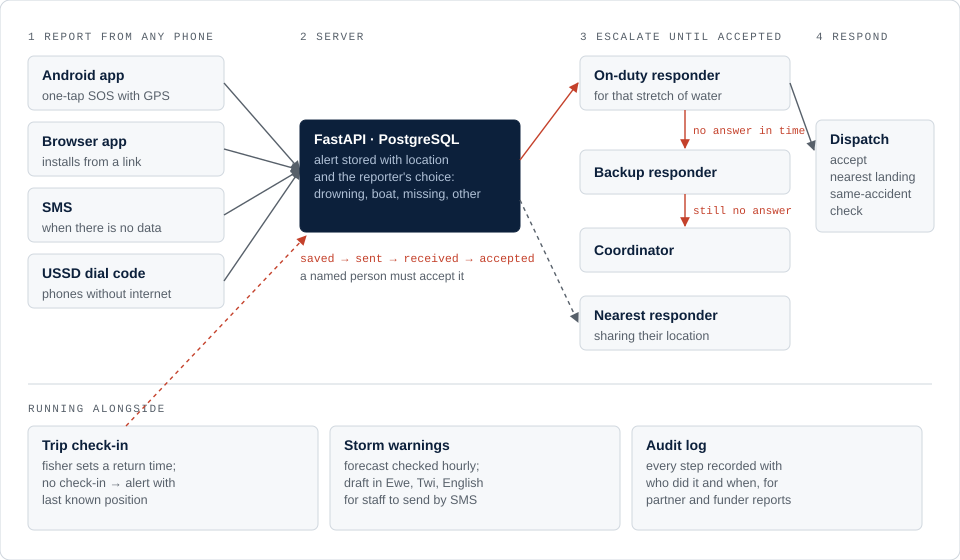
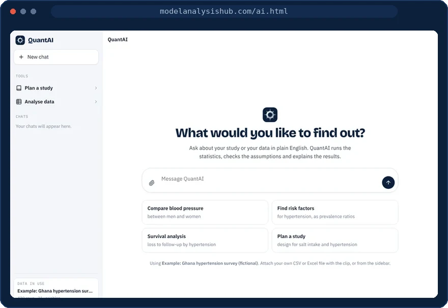
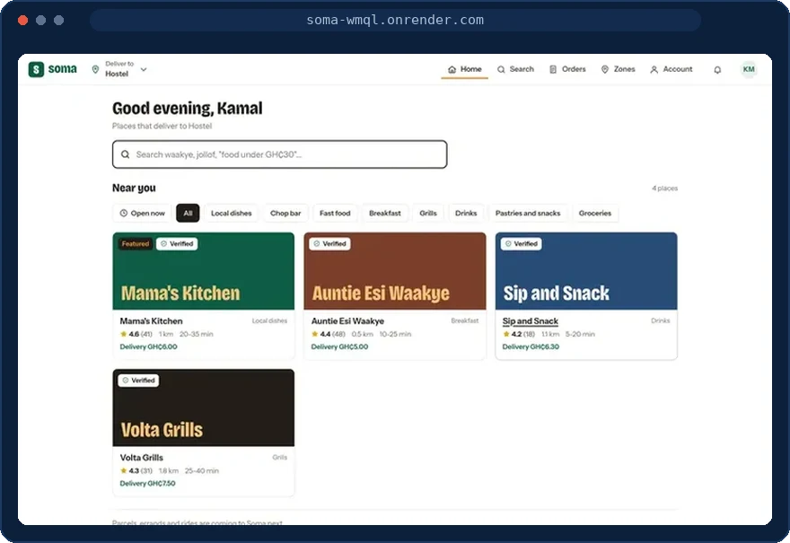
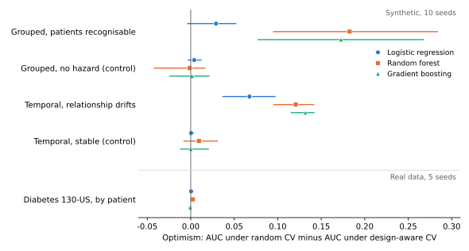
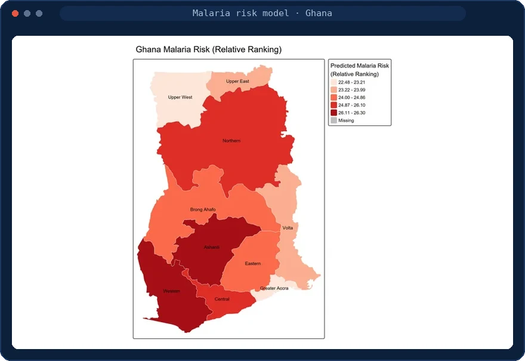
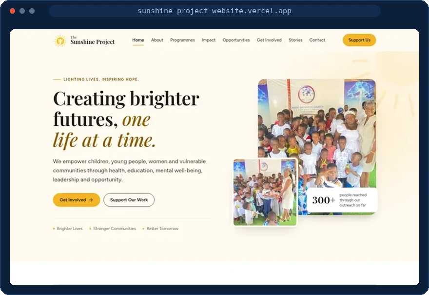
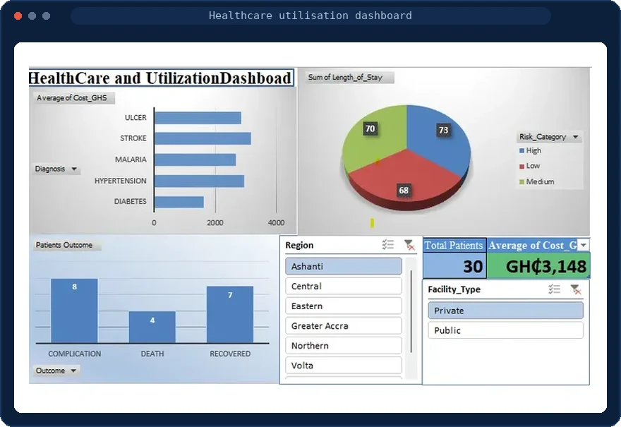
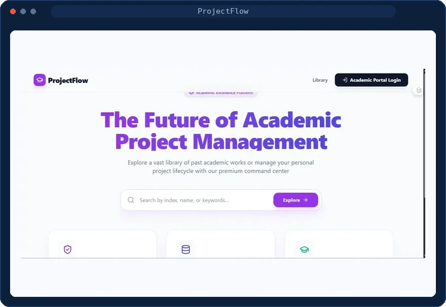

  <a href="https://modelanalysishub.com">modelanalysishub.com</a> &nbsp;·&nbsp;
  <a href="https://www.linkedin.com/in/amadu-kamal-65ab5326a">LinkedIn</a> &nbsp;·&nbsp;
  <a href="mailto:amadukamal8@gmail.com">amadukamal8@gmail.com</a> &nbsp;·&nbsp;
  <a href="https://wa.me/233595586430">WhatsApp</a>

I trained in public health (BPH, Health Information, University of Health and Allied Sciences) and I write software. Most of my work sits where those meet: a model is only finished when someone can act on it, so I build the statistics and the system around them.

**Now**
- Taking **SafeWatch** from testing to a field trial at landing sites on the Volta Lake.
- Maintaining **QuantAI**, an in-browser statistics engine, and **ResearchGuard ML**, a validation tool for clinical prediction models.
- Weekly updates to a [funded-opportunities board](https://modelanalysishub.com/opportunities.html) for Ghanaian students.

 

## Systems

### SafeWatch &nbsp;water emergency alerts for the Volta Lake · grant project · 2026

Help on the lake often starts late because nobody knows where the accident is or whose job it is to go. SafeWatch routes an SOS to a named person on duty for that stretch of water and keeps escalating until someone accepts it.

<picture>
  <source media="(prefers-color-scheme: dark)" srcset="assets/safewatch-architecture-dark.svg">
  
</picture>

- **Four ways in, one queue.** Android, an installable web app, SMS and a USSD menu all create the same alert record, so a fisher with a basic phone is served the same way as one with a smartphone.
- **Acceptance, not delivery.** An alert counts as handled only when a person accepts it. Unanswered alerts move to the backup, then the coordinator, and in parallel to the closest responder sharing a location.
- **Alerts nobody has to send.** A missed trip check-in raises an alert by itself with the last known position. The forecast is checked hourly and storm warnings are drafted in Ewe, Twi and English for staff to send.

<code>Python</code> <code>FastAPI</code> <code>PostgreSQL</code> <code>React</code> <code>TypeScript</code> <code>React Native</code> <code>Leaflet</code> <code>Africa's Talking</code> · <a href="https://modelanalysishub.com/projects.html#safewatch">case study</a> · <a href="https://safewatch-xyqr.onrender.com">live test server</a>

 

<table>
  <tr>
    <td width="50%" valign="top">
      
      <h3>QuantAI</h3>
      
A statistics engine that runs entirely in the browser, so data never leaves the user's machine. It picks each test from assumption checks (Shapiro-Wilk, Brown-Forsythe, expected counts), fits linear, logistic, Poisson, ordinal, multinomial, mixed-effects and Cox models with diagnostics, and exports every analysis as Stata, R, Python and SPSS code. Results are checked against SciPy and statsmodels.

      <code>JavaScript</code> <code>Cloudflare Workers</code> · <a href="https://modelanalysishub.com/ai.html">open it</a>
    </td>
    <td width="50%" valign="top">
      
      <h3>Soma</h3>
      
Food delivery for Ho, Hohoe and the Volta Region. Customer, vendor, rider and admin apps on one backend; Mobile Money and card payments through Paystack with automatic payouts; delivery confirmed by PIN. Admin two-step sign-in, CSRF protection and automated tests on the money flows.

      <code>Node.js</code> <code>Express</code> <code>SQLite</code> <code>Paystack</code> · <a href="https://modelanalysishub.com/projects.html#soma">case study</a>
    </td>
  </tr>
</table>

 

## Research and methods

<table>
  <tr>
    <td width="58%" valign="top">
      
    </td>
    <td width="42%" valign="top">
      <h3><a href="https://github.com/kamaldeenjnr/researchguard-ml">ResearchGuard ML</a></h3>
      
When one patient has several records, a shuffled train/test split can test a model on people it has already seen. ResearchGuard builds splits that respect patients, sites and time, verifies every fold, and reports how much the usual method inflates the score.

      
On 99,343 encounters from the Diabetes 130-US dataset, 20% of patients crossed random splits but AUC moved by at most 0.005. On data built with the problem, the inflation reached 0.18. Both results are reported.

      <code>Python</code> <code>scikit-learn</code> · v0.1.2 · 39 tests · CI on Python 3.10, 3.11 and 3.12
    </td>
  </tr>
  <tr>
    <td width="58%" valign="top">
      
    </td>
    <td width="42%" valign="top">
      <h3>Malaria risk across Ghana</h3>
      
A spatial model combining climate, population density and historical incidence to rank regional risk, estimate the probability that prevalence exceeds 30%, and compare predictions with observed prevalence region by region.

      <code>R</code> <code>Python</code> <code>ArcGIS</code> · 2025 · <a href="https://modelanalysishub.com/projects.html#malaria-risk">maps and validation</a>
      <h3><a href="https://github.com/kamaldeenjnr/stroke-risk-prediction">stroke-risk-prediction</a></h3>
      
Stroke risk on clinical data where 4.9% of patients have the outcome: SMOTE inside the pipeline and a threshold set for 80% recall, because a screening tool has to catch the people at risk.

      <code>Python</code> <code>scikit-learn</code>
    </td>
  </tr>
</table>

 

## Client and platform work

| | Project | What it is |
|---|---|---|
|  | **[The Sunshine Project](https://www.thesunshineproject.foundation)** NGO · 2026 | Website for a Ghanaian NGO with a content system their staff run themselves, on its own domain with structured data and a sitemap. |
|  | **[Healthcare utilisation dashboard](https://modelanalysishub.com/projects.html#healthcare-dashboard)** Health data | Cost by diagnosis, length of stay by risk category and outcomes, filtered by region and facility type. |
|  | **[ProjectFlow](https://modelanalysishub.com/projects.html#projectflow)** Web platform · 2025 | Research project management for universities, from undergraduate to PhD, draft to publication. |

 

## Toolkit

**Analysis** &nbsp; R · Python (pandas, NumPy, SciPy, statsmodels, scikit-learn) · Stata · ArcGIS 
**Engineering** &nbsp; TypeScript · JavaScript · FastAPI · Node.js · React · React Native · PostgreSQL · SQLite 
**Health data** &nbsp; DHIMS · e-Tracker · KoboCollect · GHILMIS 
**Infrastructure** &nbsp; GitHub Actions · Render · Vercel · Cloudflare Workers · GitHub Pages

 

Ghana · open to analysis, research and engineering work · <a href="https://modelanalysishub.com/#contact">get in touch</a>
