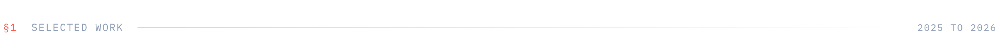
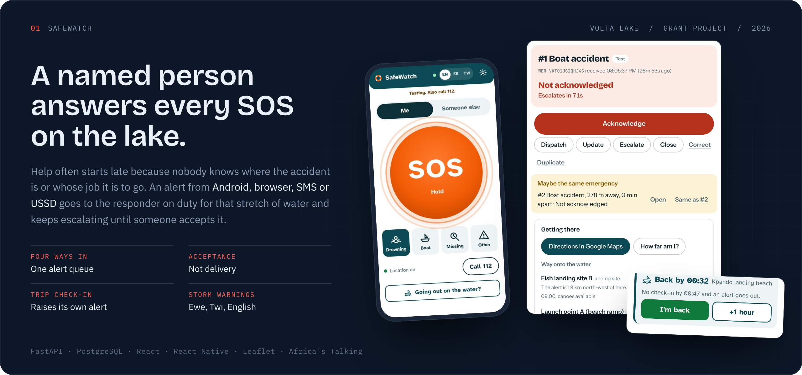
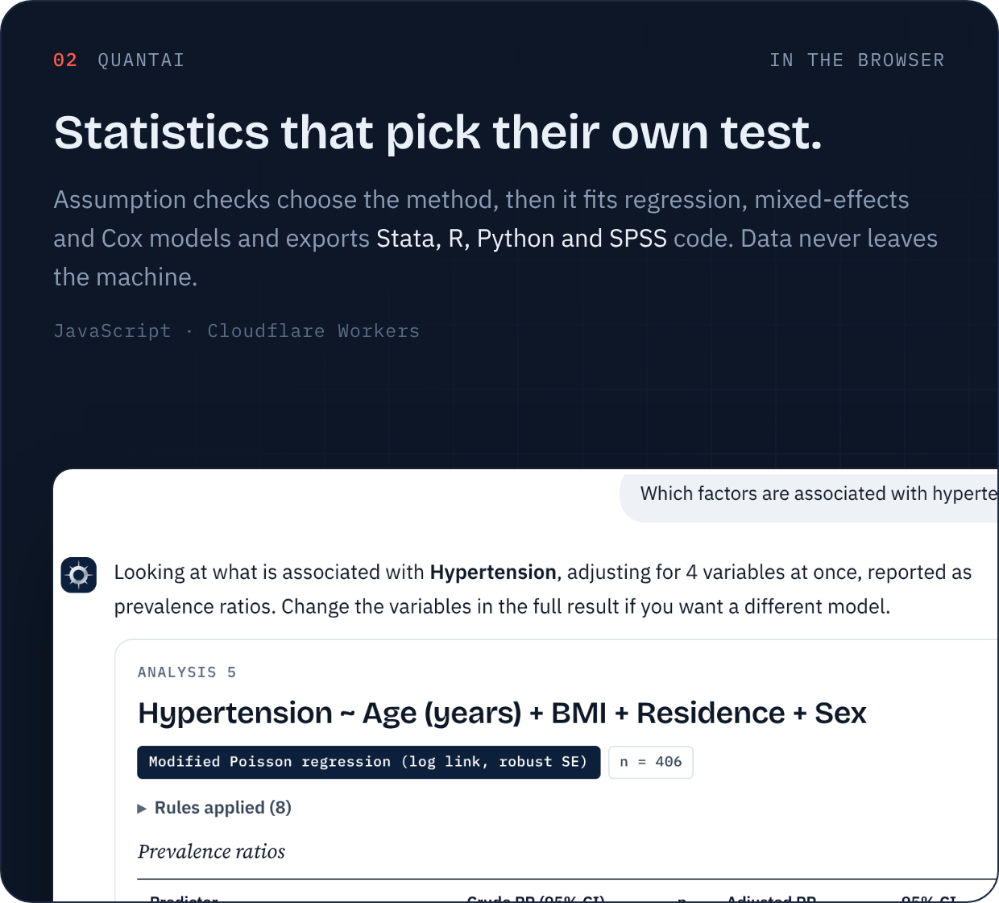
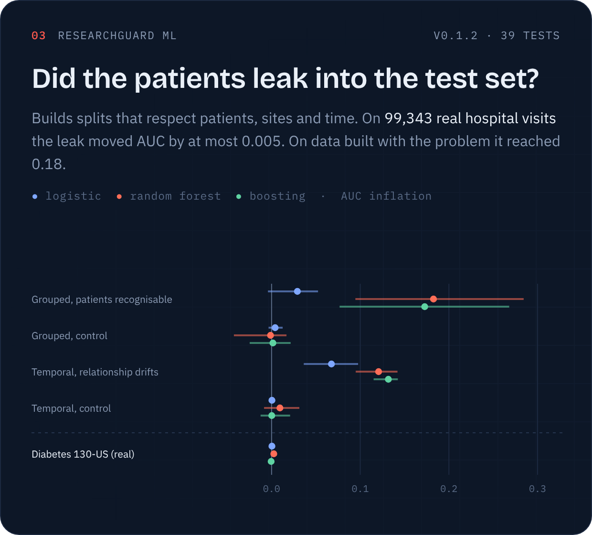
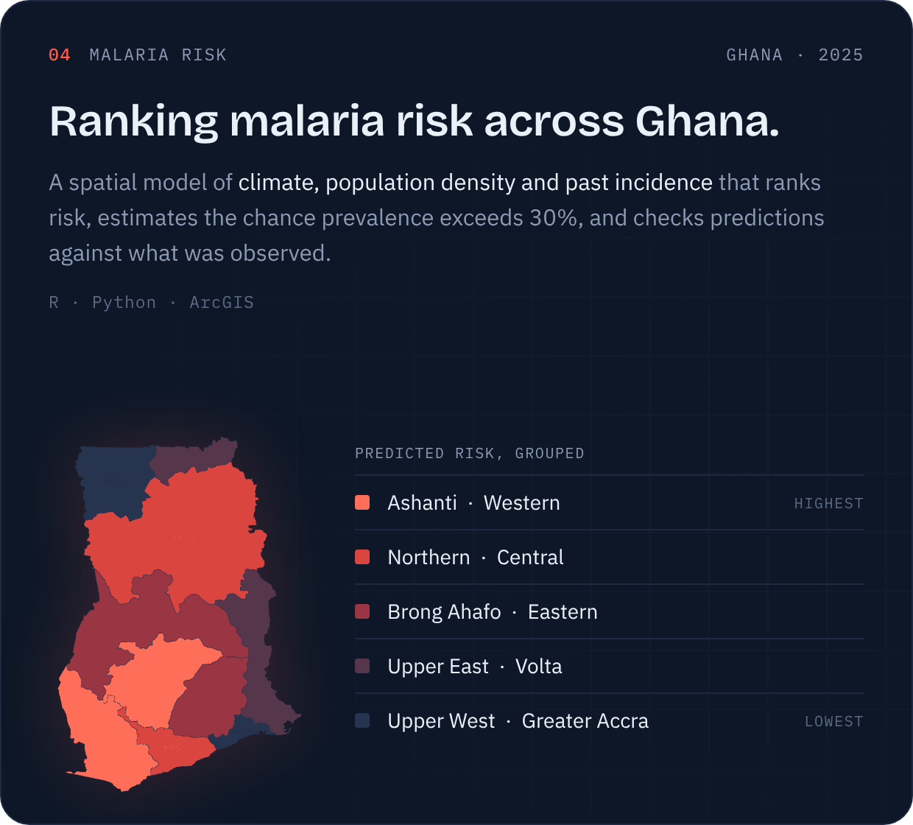
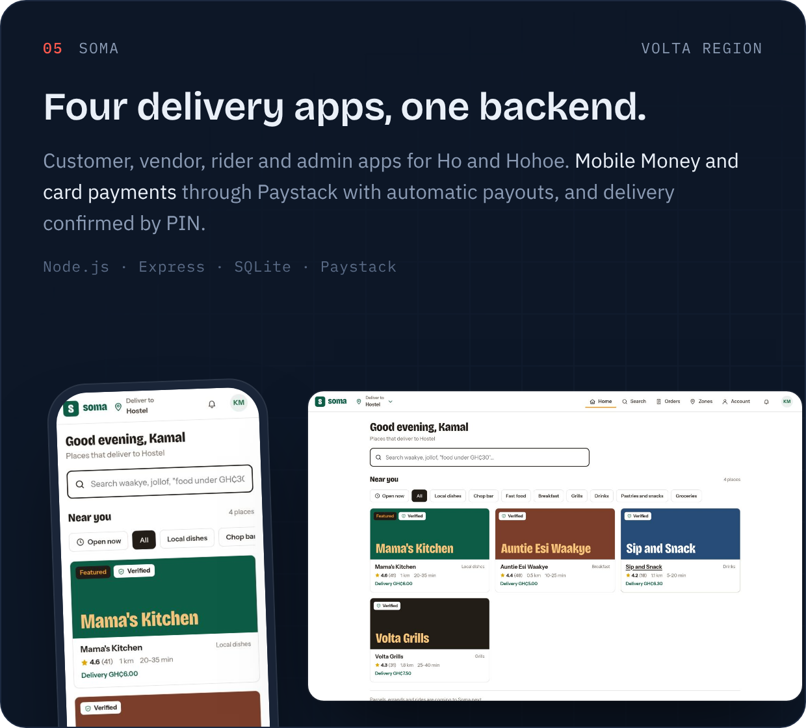
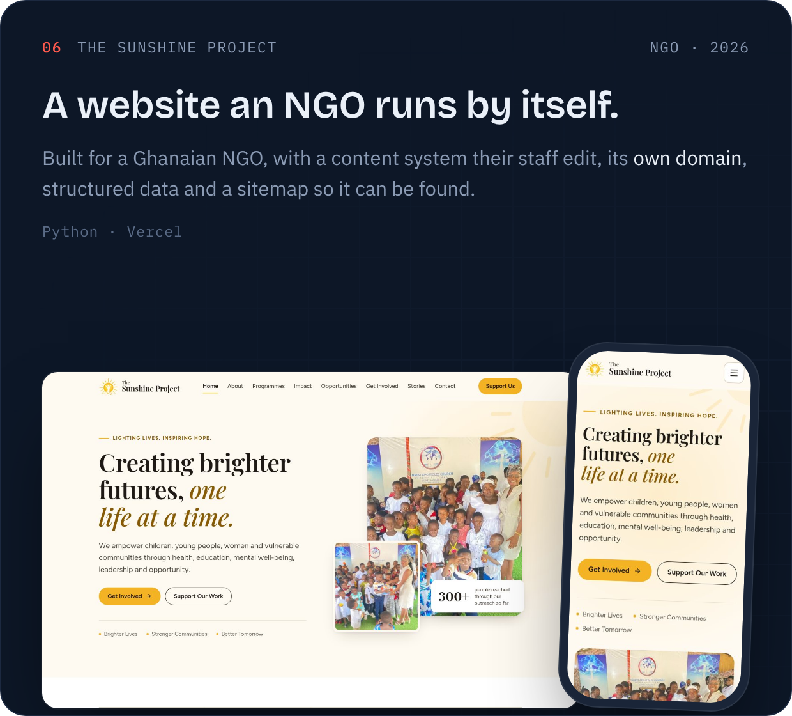
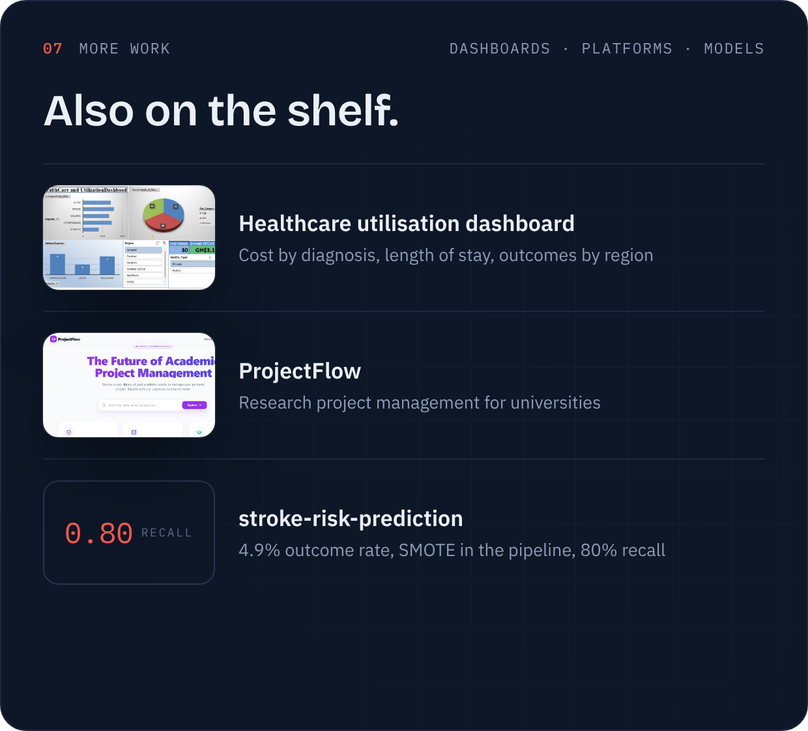
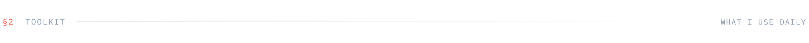
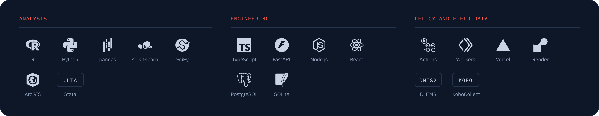

  <a href="https://modelanalysishub.com"><b>modelanalysishub.com</b></a> &nbsp;&nbsp;·&nbsp;&nbsp;
  <a href="https://www.linkedin.com/in/amadu-kamal-65ab5326a">LinkedIn</a> &nbsp;&nbsp;·&nbsp;&nbsp;
  <a href="mailto:amadukamal8@gmail.com">Email</a> &nbsp;&nbsp;·&nbsp;&nbsp;
  <a href="https://wa.me/233595586430">WhatsApp</a>

  Trained in public health (BPH, Health Information, UHAS) and I write software. 
  A model is only finished when someone can act on it, so I build the statistics and the system around them.

 

  
  

  
  

  
  

 

 

Ghana &nbsp;·&nbsp; open to analysis, research and engineering work &nbsp;·&nbsp; <a href="https://modelanalysishub.com/#contact">get in touch</a>

